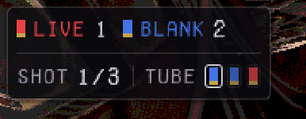
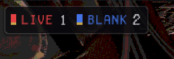
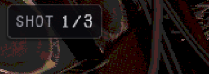
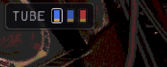

# Shell Reveal & Counter

<table>
  <tr>
    <td align="center" valign="bottom" width="50%">
      
      <br />
      <b>1. Full HUD (F1)</b>
    </td>
    <td align="center" valign="bottom" width="50%">
      
      <br />
      <b>2. Live &amp; Blank counts toggle (F2)</b>
    </td>
  </tr>
  <tr>
    <td align="center" valign="bottom" width="50%">
      
      <br />
      <b>3. Shot progress toggle (F3)</b>
    </td>
    <td align="center" valign="bottom" width="50%">
      
      <br />
      <b>4. Magazine tube order toggle (F4)</b>
    </td>
  </tr>
</table>

## ℹ️ About

**Shell Reveal & Counter** is a free, open-source, read-only single-player HUD mod for **Buckshot Roulette**. It displays remaining Live/Blank shell counts, shot progress, and the full magazine tube firing order in a compact two-row overlay - updating in real time as shells are fired, ejected, or inverted without modifying any original game files.

> [!IMPORTANT]
> * **Single-player only:** The overlay mounts only while the single-player scene (`res://scenes/main.tscn`) is active and detaches automatically on exit. Menus, multiplayer lobbies, and network gameplay remain completely untouched, so Steam can stay online.
> * **Double or Nothing (Endless):** Endless mode uploads scores to a Steam leaderboard. If you prefer to keep leaderboard runs completely unassisted, set `"allow_in_endless": false` in `shell-reveal-counter/hud.gd`.
> * **Script compatibility & updates:** The original shell-spawner script must match the supported version—the HUD disables itself if that script is unsupported or modified by another mod (do not bypass this check). Future game updates may require a compatible mod release.
> * If you encounter any bugs or game update incompatibilities, please report them in the [Issues](https://github.com/Naofunyan/shell-reveal-counter/issues) tab.

## 🛠️ Technologies

- `Godot 4`
- `GDScript`
- `CanvasLayer & Control UI`
- `Godot override.cfg Autoload`
- `TranslationServer (Auto-Localization)`

## ✨ Features

Here's what **Shell Reveal & Counter** brings to your game:

- **Remaining shell counts:** Tracks **Live** and **Blank** shells left in the current load at a glance.
- **Live magazine tube order:** Displays every remaining shell in exact firing order, with the currently chambered round framed in high-contrast white. Updates immediately on Inverter flips, Beer ejections, and fired shots.
- **Shot progress counter:** Shows your current shot out of the round's total loaded shells (`SHOT X/Y`).
- **Modular visibility toggles:** Show or hide the entire HUD or individual sections mid-round with `F1`-`F4`, or switch to an icon-only ultra-compact bar.
- **Colorblind-aware palette:** Automatically inherits Buckshot Roulette's built-in colorblind shell colors and in-game typography.
- **Strictly non-invasive:** Read-only observer architecture - never patches game scripts, scenes, executables, saves, or shell sequences.

### ⚙️ Configuration options:

Customize defaults anytime by editing the `CONFIG` dictionary at the top of `shell-reveal-counter/hud.gd`:

| Option | Default | Description |
| --- | --- | --- |
| 🌐 `language` | `"auto"` | Follows the game's active locale, or force any supported code (e.g. `"en"`, `"vi"`, `"ja"`) |
| 👁️ `start_visible` | `true` | Show the HUD automatically when a round starts |
| 🔢 `start_counts` / `start_shot` / `start_tube` | `true` | Choose which HUD sections are visible on startup |
| 🏷️ `show_labels` | `true` | Set to `false` for an icon-only ultra-compact layout |
| 🏆 `allow_in_endless` | `true` | Set to `false` to disable the HUD in Double or Nothing (Endless) |
| 🖥️ `max_opacity` / `fade_rate` | `0.90` / `8.0` | Control maximum HUD opacity and fade animation speed |

> [!NOTE]
> All hotkeys (`key_master`, `key_counts`, `key_shot`, `key_tube`) and visual colors (`THEME`) can also be customized directly inside `shell-reveal-counter/hud.gd`.

### ⌨️ Keyboard shortcuts:

Control each section of the HUD on the fly without pausing:

| Action | Shortcut |
| --- | --- |
| 🎬 Toggle entire HUD on/off | <kbd>F1</kbd> |
| 🔢 Toggle Live / Blank shell counts | <kbd>F2</kbd> |
| 🎯 Toggle Shot progress counter | <kbd>F3</kbd> |
| 📃 Toggle Magazine Tube order strip | <kbd>F4</kbd> |

## 📋 Requirements

- Your own clean **Windows Steam** copy of **Buckshot Roulette v2.2.0**.
- **Zero extra dependencies:** No Python, installer, mod loader, or Steam launch options are required.

> [!NOTE]
> Other game versions and native Linux / Bazzite / Steam Deck builds are not validated.

## 💾 Installation

You can check out the [latest release](https://github.com/Naofunyan/shell-reveal-counter/releases) to download the latest version of Shell Reveal & Counter.

1. From code button, select Download ZIP
2. Close the game
3. In Steam,  right-click Buckshot Roulette > Manage > Browse local files
4. Inside `Buckshot Roulette_windows`, extract `override.cfg` and the `shell-reveal-counter/` folder directly in the game's root directory like this:
   ```text
   Buckshot Roulette/
   ├── Original Soundtrack
   ├── Buckshot Roulette.exe
   ├── override.cfg
   ├── steam_api64.dll
   └── shell-reveal-counter/
       ├── loader.gd
       └── hud.gd
5. Launch through Steam and start single-player. The counter appears when shells are loaded. F1 hides or shows it.

> [!IMPORTANT]
> If `Buckshot Roulette_windows` already contains an `override.cfg` from another mod, keep that file and follow the merge instructions below instead of overwriting it. You can safely replace the `shell-reveal-counter` scripts when updating this mod.

### 🔀 If `override.cfg` already exists

1. Back up the existing `override.cfg` in `Buckshot Roulette_windows`.
2. Open it in a text editor and add this entry to the existing `[autoload]` section (if `[autoload]` does not exist, add that header first):
   ```ini
   [autoload]
   ShellRevealCounter="*res://shell-reveal-counter/loader.gd"
   ShellRevealCounterSteam="*res://Buckshot Roulette_windows/shell-reveal-counter/loader.gd"

### 🗑️ Uninstallation

1. Close **Buckshot Roulette**.
2. Delete the `shell-reveal-counter` folder.
3. Remove `override.cfg` from `Buckshot Roulette_windows`. If `override.cfg` is shared with another mod, remove only the `ShellRevealCounter` entry and keep everything else intact.

> [!WARNING]
> **DO NOT** delete `Buckshot Roulette_windows` - that folder contains the actual game.

No restore tool is needed. This mod never modifies the game executable or your save files.

### 🌐 Language support:

Shell Reveal & Counter automatically detects Buckshot Roulette's in-game language and falls back cleanly to a system font whenever extended characters or diacritics are needed. Currently supported across **16 languages**:

English, Vietnamese, French, German, Spanish, Italian, Portuguese, Polish, Russian, Ukrainian, Turkish, Estonian, Japanese, Korean, Simplified Chinese, Traditional Chinese

If you would like to refine a translation or contribute a new language, please let me know in the [Issues](https://github.com/Naofunyan/shell-reveal-counter/issues) tab!

## ⚖️ License

The source code is licensed under the [GNU General Public License v3.0](LICENSE).